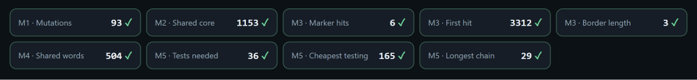

# Assignment 4. Patient Zero

Student ID: 252971@astanait.edu.kz
Name: Ingkar Tolegen
Group: SE-2540

This file is the report. Fill it in as you go. How to start: `START_HERE.md`. The task: `docs/Assignment4.pdf`.

## Program output

The 9 lines your program prints on your data (`java -cp out Main`):

    Mutations: 93
    Shared core: 1153
    Marker hits: 6
    First hit: 3312
    Border length: 3
    Shared words: 504
    Tests needed: 36
    Cheapest testing: 165
    Longest chain: 29

My outbreak report (a screenshot of `output/outbreak.html`):

## Questions

Mission 1. What does the cell d[i][j] of your table mean, and how is it computed from other cells?

d[i][j] shows how many changes we need to get the first j letters of B from the first i letters of A. When the two letters are the same, I just take the value from the diagonal, d[i-1][j-1]. When they are different, I take the smallest of the three neighbours (replace, delete, insert) and add 1.

Mission 2. How is the longest common subsequence different from the longest common substring? My Shared core is bigger than the number of letters that are the same at the same place: why?

For a substring all letters must stand together, so one different letter breaks it. For a subsequence we can skip letters, so the table keeps the best result from the top or from the left cell. Shared core is bigger because the strains are shifted after inserts and deletes, so many equal letters are at different places, but they are still in the same order.

Mission 3. What does the prefix function tell you, and why does the pointer in the text never go back in KMP? What is the Border length of my marker and what does it mean?

The prefix function says, for every position of the marker, how long the longest prefix is that is also the end (suffix) of the part we have read. In KMP, when a letter does not match, we don't go back in the text. We only move k in the marker using the table, because we already know that these letters match. My Border length is <число>, it means that <your explanation, for example: the first <число> letters of my marker are the same as the last <число> letters, so two hits can overlap>.

Mission 4. Why must you compare the letters after the hashes are equal? What happens to the cost of Rabin-Karp if many windows have the same hash?

Different words can have the same hash, it is called a collision. So if the hashes are equal, the words can still be different, and I check the letters. If many windows have the same hash, I must check each of them, and it costs O(k) every time. Then the algorithm becomes slow, up to O(n*k) in the worst case.

Mission 5. What are the two states of a person in your DP, and how do you get the answer for a person from its children? Why does a greedy "test the person with most links first" not always give the cheapest answer?

Every person has two states: take[v] (we test this person) and skip[v] (we don't test this person). If v is tested, his children are free, so for each child I add the smaller of take and skip, plus the cost of v. If v is not tested, every child must be tested, so I add take of all children. Greedy can fail because the person with most links can be very expensive, and it can be cheaper to test his neighbours. <свой пример: дерево из 4-5 людей с ценами>

## AI use

I used Claude as a helper. It explained the ideas of the algorithms and gave me code examples, and it helped me with Git and compile errors. After that I read the code, traced the algorithms by hand on `examples/tiny` and checked everything with `tools/Check.java` and the lab console. I did not copy code from books or websites.

## Timing (Mission 7)

Milliseconds, average of 3 runs, from `java -cp out Bench`.

| test | size | time |
|---|---|---|
| naive search | 20 000 / 40 000 / 80 000 | 85,7 / 155,7 / 261,0 |
| KMP | 20 000 / 40 000 / 80 000 | 0,5 / 0,0 / 0,0 |
| edit distance | 500 / 1000 / 2000 / 4000 | 14,9 / 11,7 / 33,4 / 155,7 |

What do the numbers say about how the time grows? When you double the size, by how much does each time grow? Two or three sentences.

When the text becomes two times longer, the naive search also takes about two times more time (85.7 -> 155.7 -> 261 ms), but it is much slower than KMP because it checks the pattern of length 2000 again at almost every position. KMP is so fast that the time is about 0 ms: it is linear and the timer cannot measure it. For edit distance, when the length is doubled, the time grows about four times (33.4 -> 155.7 ms), because the table has n x m cells. The first two values (500 and 1000) are not stable because Java is still warming up.

## Complexity

n is the length of the text (or of a strain), m the length of the pattern, k the length of the window, v the number of people. Fill in every algorithm you wrote.

| algorithm | time | space | assumptions |
|---|---|---|---|
| Edit distance | O(n*m) | O(n*m) | full table (n+1) x (m+1), every cell in O(1) |
| LCS | O(n*m) | O(n*m) | same table as edit distance |
| Prefix function and KMP | O(n+m) | O(m) | the text pointer never goes back; the list of answers is not counted |
| Rabin-Karp (shared words) | O(n+m) on average, O(n*k) worst case | O(m) | rolling hash in O(1); worst case many equal hashes, each checked in O(k); hash table of the windows of B |
| Tree DP | O(v) | O(v) | every person and link is visited once; BFS order, no recursion |

## Before you submit

- The four files in `data` and the screenshot `output/outbreak.png` are in the repository.
- `java tools/Check.java` shows all examples right.
- This README is filled in, the program output and the section AI use included.
- The work is pushed to main (at least one commit per mission) and the repository is public.
- The link is attached in Moodle.